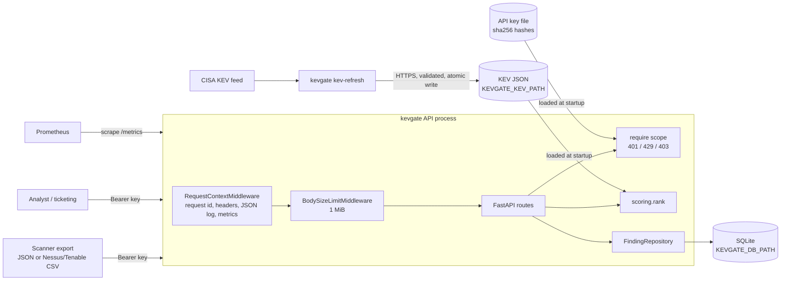

# kevgate

kevgate is a small vulnerability intake service. Scanner findings go in, and a remediation queue comes out, ranked by known exploitation (CISA KEV), exploit likelihood (EPSS), severity (CVSS) and how much the affected asset matters (asset criticality rating, ACR).

## Why I built it

During my internship on a vulnerability assessment team I spent a lot of time prioritizing findings by whether the CVE was on the CISA Known Exploited Vulnerabilities list. A raw scanner export sorts by CVSS, which puts a theoretical 9.8 ahead of a 7.5 that attackers are using right now. KEV membership is the strongest signal we had, so I wanted a service that makes it the dominant factor and still uses EPSS, CVSS and asset criticality to order everything else.

The service itself is deliberately small. The point of the repo is to run it the way a production team would: tested, authenticated, rate limited, observable, threat modeled, and deployed with a hardened container, Kubernetes and Terraform.

## How scoring works

```
risk = 100 * (0.40 * kev + 0.25 * acr/8 + 0.20 * epss + 0.20 * cvss/10) / 1.05
```

`kev` is 1 if the CVE is in the loaded KEV catalog, else 0. The result is rounded to one decimal and always falls in 0..100. Because the KEV weight (0.40) equals the combined EPSS and CVSS weights, a KEV finding never scores below a non-KEV finding on an asset with the same ACR. The only tie is the degenerate case of a KEV finding with CVSS 0 and EPSS 0 against a non-KEV finding with CVSS 10 and EPSS 1, and the queue breaks that tie in favor of KEV. The queue order is risk, then KEV, then EPSS, then CVSS, all descending.

## Quick start

```bash
python -m venv .venv && source .venv/Scripts/activate   # .venv/bin/activate on Linux/macOS
pip install -e ".[dev]"
make test        # or: pytest --cov=kevgate

# Dev server: no key file, so auth is disabled and a warning is logged
KEVGATE_DB_PATH=./kevgate.db uvicorn kevgate.main:app --port 8000
```

With authentication on:

```bash
kevgate keygen --scope findings:write --scope queue:read --key-id scanner
# key:  kvg_...        give this to the client now, it is never shown again
# line: scanner:findings:write,queue:read:<sha256>

echo 'scanner:findings:write,queue:read:<sha256 from the line above>' >> keys.txt
KEVGATE_ENV=prod KEVGATE_DB_PATH=./kevgate.db KEVGATE_API_KEYS_FILE=./keys.txt \
  uvicorn kevgate.main:app --port 8000
```

## API

Full reference with request and response examples: [docs/API.md](docs/API.md).

| Method | Path | Scope | What it does |
|---|---|---|---|
| GET | `/healthz` | none | Liveness. Always 200 if the process is serving. |
| GET | `/readyz` | none | 200 if the database answers and the KEV catalog is loaded, else 503. |
| GET | `/metrics` | none | Prometheus text format. |
| POST | `/findings` | `findings:write` | JSON list of up to 1000 findings. Upsert on (cve, asset). 201 `{"accepted": n}`. |
| POST | `/findings/import` | `findings:write` | Nessus/Tenable CSV export as `text/csv`. 201 `{"accepted": n, "skipped": m}`. |
| GET | `/queue?limit=&kev_only=&asset=` | `queue:read` | Ranked queue. `limit` 1..100, default 10. |
| GET | `/findings/{cve}` | `queue:read` | Every asset with that CVE, scored. 404 if none. |
| DELETE | `/findings/{cve}?asset=` | `admin` | Remove one finding. 204, or 404 if it does not exist. |
| GET | `/stats` | `queue:read` | KEV vs non-KEV counts and mean CVSS, EPSS and days open, plus top assets by total risk. |

`admin` implies every other scope.

```bash
KEY=kvg_...   # a key with findings:write and queue:read
curl -s -X POST localhost:8000/findings -H "Authorization: Bearer $KEY" \
  -H 'Content-Type: application/json' \
  -d '[{"cve":"CVE-2021-44228","asset":"web-01","acr":7,"cvss":10.0,"epss":0.97,"days_open":12}]'
# {"accepted":1}

curl -s -X POST 'localhost:8000/findings/import?default_acr=6' -H "Authorization: Bearer $KEY" \
  -H 'Content-Type: text/csv' --data-binary @tests/fixtures/tenable_export.csv
# {"accepted":5,"skipped":2}

curl -s 'localhost:8000/queue?limit=3&kev_only=true' -H "Authorization: Bearer $KEY"
curl -s localhost:8000/findings/CVE-2021-34527 -H "Authorization: Bearer $KEY"
curl -s localhost:8000/stats -H "Authorization: Bearer $KEY"
curl -s -X DELETE 'localhost:8000/findings/CVE-2021-44228?asset=web-01' -H "Authorization: Bearer $ADMIN_KEY"
curl -s localhost:8000/readyz
```

## CLI

| Command | What it does |
|---|---|
| `kevgate serve [--host] [--port]` | Runs uvicorn with the server header and the duplicate access log turned off. |
| `kevgate keygen --scope S [--scope S] [--key-id ID]` | Prints a new key once, plus the `key_id:scopes:sha256` line for the key file. |
| `kevgate import-csv FILE [--default-acr N] [--db PATH]` | Loads a scanner CSV straight into the database, in batches, with no 1000-finding cap. |
| `kevgate kev-refresh [--output PATH] [--url URL] [--timeout S]` | Downloads the CISA KEV feed over HTTPS, validates it and atomically replaces the local file. The service loads KEV at startup, so restart it afterwards. |

## Configuration

| Variable | Default | Notes |
|---|---|---|
| `KEVGATE_ENV` | `dev` | `dev` or `prod`. Prod disables `/docs`, `/redoc` and `/openapi.json`, and refuses to start without a key file. |
| `KEVGATE_DB_PATH` | `/data/kevgate.db` | SQLite file. The only path the server writes to (plus SQLite's `-wal` and `-shm` files next to it). |
| `KEVGATE_KEV_PATH` | bundled `kevgate/data/kev_sample.json` | KEV catalog in the CISA JSON schema. A missing or invalid file makes `/readyz` return 503. |
| `KEVGATE_API_KEYS_FILE` | unset | Lines of `key_id:scopes:sha256hex`. Unset in dev means auth is disabled with a warning. Unset in prod means the process exits. |
| `KEVGATE_RATE_LIMIT_PER_MIN` | `120` | Token bucket size and refill per minute, per API key. |
| `KEVGATE_LOG_LEVEL` | `INFO` | Standard Python level names. |

Fixed limits: 1 MiB request body, 1000 findings per request.

## Security controls

The full STRIDE analysis is in [docs/THREAT_MODEL.md](docs/THREAT_MODEL.md).

| Control | Threat it addresses | Limitation |
|---|---|---|
| Bearer API keys, 256-bit random, stored as SHA-256 only | Unauthenticated writes or reads; key theft from the key file or a backup | No expiry or rotation workflow; revoking means editing the file and restarting |
| Constant-time digest compare across all keys | Timing attacks that recover a key or confirm a key_id | Key count is observable in principle, not considered sensitive |
| Scopes (`findings:write`, `queue:read`, `admin`), 401 vs 403 | A scanner key reading the queue, or any non-admin deleting findings | Scopes are coarse; no per-asset authorization |
| Fail closed in prod without keys; malformed key file aborts startup | Accidentally deploying an open API | Dev mode is open by design |
| Per-key token bucket, 429 with `Retry-After` | One client exhausting the service | In memory, so per replica and reset on restart; no limit on failed auth attempts beyond what the ingress provides |
| 1 MiB body limit (declared and streamed), 1000 findings per request | Memory exhaustion via large or chunked bodies | Limits are compiled in, not configurable |
| Strict Pydantic models (`extra="forbid"`, no coercion, no NaN, printable asset names, CVE regex) | Mass assignment, type confusion, log injection through asset names | Asset names are free text within those rules |
| 422 responses never echo submitted values | Reflection of client data; crash on non-JSON-safe input such as NaN | Error messages still name the failing field |
| Parameterised SQL everywhere, CHECK constraints in the schema | SQL injection; invalid rows if validation is ever bypassed | SQLite is single-writer |
| JSON access log with key_id and request id, never keys or bodies | Repudiation; secrets in logs | Logs are only as durable as the platform's log pipeline |
| Security headers (`nosniff`, `no-store`, `DENY`, strict CSP, no referrer) | Content sniffing, caching of API responses, framing | `/docs` in dev is exempt from CSP; uvicorn's `server` header is only removed via `kevgate serve` or `--no-server-header` |
| KEV refresh is a separate CLI: HTTPS only, timeout, 32 MiB cap, schema and count validation, atomic replace | Tampered or truncated feed; the API making outbound calls | Trusts CISA's TLS endpoint; no signature on the feed |

## Architecture



Module map: `app.py` (factory and routes), `auth.py`, `ratelimit.py`, `middleware.py`, `db.py`, `scoring.py`, `kev.py`, `csv_import.py`, `config.py`, `logs.py`, `metrics.py`, `cli.py`, `main.py` (ASGI entry point built from env vars).

## Tests and quality

Numbers from my last run on Windows, Python 3.12.2:

- `pytest`: 227 tests passed in 8.2 s, including the original M1 contract tests unchanged, Hypothesis property tests for the scoring bounds and KEV ordering, the full auth matrix, rate limiting, body and count limits, CSV edge cases, KEV refresh with a mocked network, repository upserts and readiness failure.
- Coverage: 957 statements, 0 missed; 99.91% with branch coverage on (one partial branch).
- `ruff check .` and `ruff format --check .`: clean.
- `mypy --strict src`: no issues in 15 source files.

```bash
make lint && make type && make test
```

## Deployment

The service ships as a hardened container, a Helm chart, Terraform for AWS, and a GitHub Actions
security pipeline. Start with [docs/DEPLOYMENT.md](docs/DEPLOYMENT.md); the pipeline is described in
[docs/PIPELINE.md](docs/PIPELINE.md), alerts and incident playbooks in [docs/RUNBOOK.md](docs/RUNBOOK.md),
and the threat model in [docs/THREAT_MODEL.md](docs/THREAT_MODEL.md).

What has actually been run (and where) is written down in those docs. Static validation (helm lint,
kubeconform, terraform validate, checkov, trivy config, promtool, actionlint) was run locally. The image
build, kind deployment, LocalStack apply and DAST scans run in GitHub Actions. Nothing is deployed to a
real AWS account.

## License

MIT
