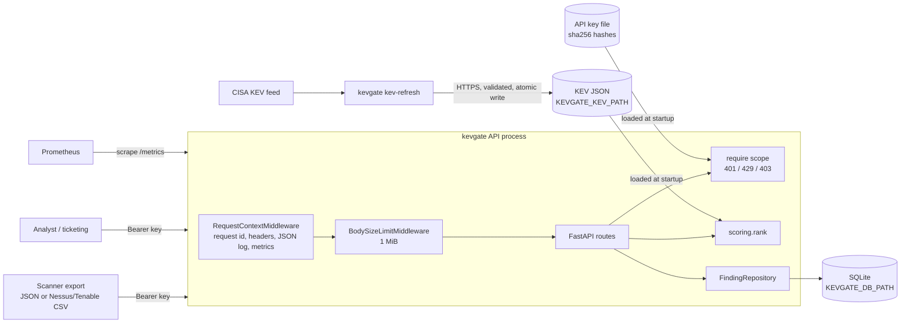

# kevgate

[](https://github.com/samiali38183/kevgate/actions/workflows/ci.yml)
[](https://github.com/samiali38183/kevgate/actions/workflows/security.yml)
[](https://github.com/samiali38183/kevgate/actions/workflows/deploy-kind.yml)
[](https://github.com/samiali38183/kevgate/actions/workflows/terraform.yml)

kevgate takes scanner findings in and gives back a remediation queue, ranked by whether the CVE is known to be exploited (CISA KEV), how likely exploitation is (EPSS), severity (CVSS) and how much the affected asset matters (asset criticality rating, ACR). The service is small on purpose. Most of the repository is the packaging around it: API keys and rate limiting, a locked-down container, a Helm chart, Terraform, and a CI pipeline that scans and signs what it ships.

| | |
|---|---|
| Ranking | KEV membership carries 0.40 of the score, so a KEV finding never ranks below a non-KEV one on the same asset. The weights are my choice and I have not checked them against remediation outcomes. |
| Tests | 277 pytest tests, 99.92% branch coverage (CI floor 90%), `ruff` and `mypy --strict` clean. They include Hypothesis property tests and tests that pin defects earlier tests missed. |
| Pipeline | CI runs Semgrep, Bandit, `pip-audit` on a hashed lock, gitleaks, checkov, Trivy on the image, a kind deploy with NetworkPolicy and Pod Security checks, a ZAP baseline scan, and Terraform against LocalStack ([pipeline](docs/PIPELINE.md)). |
| Release | `v0.1.1` image on GHCR, signed with cosign (keyless), with provenance and SBOM attestations. `gh attestation verify` passed from a machine outside the workflow. |
| Not done | Nothing is deployed to a real AWS account. The service runs as one replica on SQLite. See [Status and limits](#status-and-limits). |

Try it (Python 3.11+):

```bash
python -m venv .venv && source .venv/bin/activate       # Windows: .venv\Scripts\activate
pip install -e ".[dev]" && pytest -q                    # 277 tests
KEVGATE_DB_PATH=./kevgate.db uvicorn kevgate.main:app --port 8000      # dev mode: auth off, a warning is logged
```

```
$ curl -s -X POST localhost:8000/findings -H 'Content-Type: application/json' -d '[
    {"cve":"CVE-2021-44228","asset":"web-01","acr":7,"cvss":10.0,"epss":0.97,"days_open":12},
    {"cve":"CVE-2023-99999","asset":"db-01","acr":8,"cvss":9.8,"epss":0.02,"days_open":30}]'
{"accepted":2}
$ curl -s 'localhost:8000/queue?limit=3'
[{"cve":"CVE-2021-44228","asset":"web-01",...,"kev":true,"risk":96.5},
 {"cve":"CVE-2023-99999","asset":"db-01",...,"kev":false,"risk":42.9}]
```

The log4j CVE is in the bundled sample KEV catalog, so it outranks a CVSS 9.8 on a more critical asset. The second CVE is made up. More requests, including authentication, are under [API](#api).

## Why it exists

A raw scanner export sorts by CVSS, which puts a theoretical 9.8 above a 7.5 that attackers are using today. Membership in the CISA Known Exploited Vulnerabilities (KEV) catalog is the strongest signal I know of, so it dominates the score, and EPSS, CVSS and asset criticality order everything else. Vulnerability-management teams use the same idea. I wrapped it in a small API so I would have something real to test, authenticate, rate limit, monitor, threat model and package.

## Status and limits

- One replica, SQLite on one volume, `Recreate` rollouts. That is a limitation, not a production design. [docs/DEPLOYMENT.md](docs/DEPLOYMENT.md#what-would-change-for-production) lists what would have to change.
- Nothing is deployed to a real AWS account. The Terraform (ECR, reports bucket, KMS key, workload and CI roles) has no consumer: the service does not call AWS and releases go to GHCR. I only applied it to LocalStack.
- The scoring weights have not been evaluated against remediation outcomes.

## How scoring works

```
risk = 100 * (0.40 * kev + 0.25 * acr/8 + 0.20 * epss + 0.20 * cvss/10) / 1.05
```

`kev` is 1 if the CVE is in the loaded KEV catalog, else 0. The result is rounded to one decimal and always falls in 0..100. The KEV weight (0.40) equals the EPSS and CVSS weights combined, so a KEV finding never scores below a non-KEV finding on an asset with the same ACR. The only tie is a KEV finding with CVSS 0 and EPSS 0 against a non-KEV finding with CVSS 10 and EPSS 1, and the queue puts KEV first. Queue order is risk, then KEV, then EPSS, then CVSS, all descending.

## Quick start

```bash
python -m venv .venv && source .venv/Scripts/activate   # .venv/bin/activate on Linux/macOS
pip install -e ".[dev]"
make test        # or: pytest --cov=kevgate

# Dev server: no key file, so auth is disabled and a warning is logged
KEVGATE_DB_PATH=./kevgate.db uvicorn kevgate.main:app --port 8000
```

With authentication on:

```bash
kevgate keygen --scope findings:write --scope queue:read --key-id scanner
# key:  kvg_...        give this to the client now, it is never shown again
# line: scanner:findings:write,queue:read:<sha256>

echo 'scanner:findings:write,queue:read:<sha256 from the line above>' >> keys.txt
KEVGATE_ENV=prod KEVGATE_DB_PATH=./kevgate.db KEVGATE_API_KEYS_FILE=./keys.txt \
  uvicorn kevgate.main:app --port 8000
```

## API

Full reference with request and response examples: [docs/API.md](docs/API.md).

| Method | Path | Scope | What it does |
|---|---|---|---|
| GET | `/healthz` | none | Liveness. Always 200 if the process is serving. |
| GET | `/readyz` | none | 200 if the database answers, accepts a (rolled-back) write and passes a quick integrity check, its directory is writable with headroom, and the KEV catalog is loaded; else 503. |
| GET | `/metrics` | none | Prometheus text format. |
| POST | `/findings` | `findings:write` | JSON list of up to 1000 findings. Upsert on (cve, asset). 201 `{"accepted": n}`. |
| POST | `/findings/import` | `findings:write` | Nessus/Tenable CSV export as `text/csv`. 201 `{"accepted": n, "skipped": m}`. |
| GET | `/queue?limit=&kev_only=&asset=` | `queue:read` | Ranked queue. `limit` 1..100, default 10. |
| GET | `/findings/{cve}` | `queue:read` | Every asset with that CVE, scored. 404 if none. |
| DELETE | `/findings/{cve}?asset=` | `admin` | Remove one finding. 204, or 404 if it does not exist. |
| GET | `/stats` | `queue:read` | KEV vs non-KEV counts and mean CVSS, EPSS and days open, plus top assets by total risk. |

`admin` implies every other scope.

```bash
KEY=kvg_...   # a key with findings:write and queue:read
curl -s -X POST localhost:8000/findings -H "Authorization: Bearer $KEY" \
  -H 'Content-Type: application/json' \
  -d '[{"cve":"CVE-2021-44228","asset":"web-01","acr":7,"cvss":10.0,"epss":0.97,"days_open":12}]'
# {"accepted":1}

curl -s -X POST 'localhost:8000/findings/import?default_acr=6' -H "Authorization: Bearer $KEY" \
  -H 'Content-Type: text/csv' --data-binary @tests/fixtures/tenable_export.csv
# {"accepted":5,"skipped":2}

curl -s 'localhost:8000/queue?limit=3&kev_only=true' -H "Authorization: Bearer $KEY"
curl -s localhost:8000/findings/CVE-2021-34527 -H "Authorization: Bearer $KEY"
curl -s localhost:8000/stats -H "Authorization: Bearer $KEY"
curl -s -X DELETE 'localhost:8000/findings/CVE-2021-44228?asset=web-01' -H "Authorization: Bearer $ADMIN_KEY"
curl -s localhost:8000/readyz
```

## CLI

| Command | What it does |
|---|---|
| `kevgate serve [--host] [--port]` | Runs uvicorn with the server header and the duplicate access log turned off. |
| `kevgate keygen --scope S [--scope S] [--key-id ID]` | Prints a new key once, plus the `key_id:scopes:sha256` line for the key file. |
| `kevgate import-csv FILE [--default-acr N] [--db PATH]` | Loads a scanner CSV straight into the database, in batches, with no 1000-finding cap. |
| `kevgate kev-refresh [--output PATH] [--url URL] [--timeout S]` | Downloads the CISA KEV feed over HTTPS, validates it and atomically replaces the local file. The service loads KEV at startup, so restart it afterwards. |

## Configuration

| Variable | Default | Notes |
|---|---|---|
| `KEVGATE_ENV` | `dev` | `dev` or `prod`. Prod disables `/docs`, `/redoc` and `/openapi.json`, and refuses to start without a key file. |
| `KEVGATE_DB_PATH` | `/data/kevgate.db` | SQLite file. The only path the server writes to (plus SQLite's `-wal` and `-shm` files next to it). |
| `KEVGATE_KEV_PATH` | bundled `kevgate/data/kev_sample.json` | KEV catalog in the CISA JSON schema. A missing or invalid file makes `/readyz` return 503. |
| `KEVGATE_API_KEYS_FILE` | unset | Lines of `key_id:scopes:sha256hex`. Unset in dev means auth is disabled with a warning. Unset in prod means the process exits. |
| `KEVGATE_RATE_LIMIT_PER_MIN` | `120` | Token bucket size and refill per minute, per API key. |
| `KEVGATE_AUTH_FAIL_LIMIT_PER_MIN` | `20` | Failed authentications (401) allowed per minute per source address. A source that exhausts its budget gets 429 before any key is checked. |
| `KEVGATE_TRUSTED_PROXIES` | unset | Comma separated IPs or CIDRs of reverse proxies whose `X-Forwarded-For` may be trusted. Unset means the direct peer address is always used. Do not combine with `kevgate serve --proxy-headers`. |
| `KEVGATE_LOG_LEVEL` | `INFO` | Standard Python level names. |

Fixed limits: 1 MiB request body, 1000 findings per request.

## Security controls

The full STRIDE analysis is in [docs/THREAT_MODEL.md](docs/THREAT_MODEL.md).

| Control | Threat it addresses | Limitation |
|---|---|---|
| Bearer API keys, 256-bit random, stored as SHA-256 only | Unauthenticated writes or reads; key theft from the key file or a backup | No expiry or rotation workflow; revoking means editing the file and restarting |
| Constant-time digest compare across all keys | Timing attacks that recover a key or confirm a key_id | Key count is observable in principle, not considered sensitive |
| Scopes (`findings:write`, `queue:read`, `admin`), 401 vs 403 | A scanner key reading the queue, or any non-admin deleting findings | Scopes are coarse; no per-asset authorization |
| Fail closed in prod without keys; malformed key file aborts startup | Accidentally deploying an open API | Dev mode is open by design |
| Per-key token bucket, 429 with `Retry-After` | One client exhausting the service | In memory, so per replica and reset on restart |
| Per-source failure limiter, checked before authentication | Brute-forcing key values or ids | Keyed by source address, so clients behind one NAT share a budget and an attacker there can lock them out for a short time; address spoofing is only as hard as the network makes it |
| 1 MiB body limit (declared and streamed), 1000 findings per request | Memory exhaustion via large or chunked bodies | Limits are compiled in, not configurable |
| Strict Pydantic models (`extra="forbid"`, no coercion, no NaN, printable asset names, CVE regex) | Mass assignment, type confusion, log injection through asset names | Asset names are free text within those rules |
| 422 responses never echo submitted values | Reflection of client data; crash on non-JSON-safe input such as NaN | Error messages still name the failing field |
| Parameterised SQL everywhere, CHECK constraints in the schema | SQL injection; invalid rows if validation is ever bypassed | SQLite is single-writer |
| JSON access log with key_id and request id, never keys or bodies; every 401, 403 and throttled request also logs the client address | Repudiation; secrets in logs; no way to trace a failing source | Logs are only as durable as the platform's log pipeline |
| Security headers (`nosniff`, `no-store`, `DENY`, strict CSP, no referrer) | Content sniffing, caching of API responses, framing | `/docs` in dev is exempt from CSP; uvicorn's `server` header is only removed via `kevgate serve` or `--no-server-header` |
| KEV refresh is a separate CLI: HTTPS only, timeout, 32 MiB cap, schema and count validation, atomic replace | Tampered or truncated feed; the API making outbound calls | Trusts CISA's TLS endpoint; no signature on the feed |

## Architecture



Module map: `app.py` (factory and routes), `auth.py`, `clientip.py`, `ratelimit.py`, `middleware.py`, `db.py`, `scoring.py`, `kev.py`, `csv_import.py`, `config.py`, `logs.py`, `metrics.py`, `cli.py`, `main.py` (ASGI entry point built from env vars).

## Tests and quality

Numbers from a local run on 2026-11-13 (Windows, Python 3.12.2). The `ci` workflow runs the same suite on Linux with Python 3.11 and 3.12.

- `pytest`: 277 tests pass. They cover the first API contract tests (unchanged), Hypothesis properties for the scoring bounds and KEV ordering, the auth matrix, rate limiting and the failed-authentication limiter, body and count limits, CSV edge cases, KEV refresh against a mocked network, repository upserts, and readiness with a deliberately corrupted database file.
- Coverage: 1092 statements, 0 missed, 99.92% with branch coverage (one partial branch).
- `ruff check .` and `ruff format --check .`: clean.
- `mypy --strict src`: no issues in 16 source files.
- Infrastructure tests: `promtool test rules` passes, and `terraform test` on the OIDC trust policy passes 4 runs.

```bash
make lint && make type && make test
```

## Deployment

The service ships as a container image, a Helm chart, Terraform for AWS and a GitHub Actions security pipeline. Start with [docs/DEPLOYMENT.md](docs/DEPLOYMENT.md). The pipeline is in [docs/PIPELINE.md](docs/PIPELINE.md), alerts and incident playbooks in [docs/RUNBOOK.md](docs/RUNBOOK.md), and the threat model in [docs/THREAT_MODEL.md](docs/THREAT_MODEL.md).

Coverage does not show whether a test would notice a defect. `tests/test_mutation_kills.py` pins six behaviors that earlier survived deliberate defects: early-exit key comparison, `==` instead of `hmac.compare_digest`, `BEGIN` instead of `BEGIN IMMEDIATE`, a body counter that kept only the last chunk, a CSV merge that took the minimum CVSS, and an upsert that skipped `epss`.

The docs say where each check ran. Helm lint, kubeconform, terraform validate, checkov, trivy config, promtool and actionlint ran on my machine and run again in CI. The image build, kind deployment, LocalStack apply and ZAP scan only run in GitHub Actions. The `ci`, `security` and `deploy-kind` workflows are green on `main`. `terraform` only runs when `infra/` changes, and its last run (2026-11-11) was green.

Results from the latest `security` and `deploy-kind` runs on `main`:

- Semgrep (`p/python`, `p/owasp-top-ten`): 160 rules, 0 findings. Bandit at medium and above: 0 findings.
- `pip-audit` on the hashed lock: no known vulnerabilities. Trivy on the built image: 0 fixable HIGH or CRITICAL. The SBOM lists 104 components.
- checkov: 0 failed checks on the Dockerfile (105 passed), the two rendered chart variants (181) and Terraform (138, 13 skipped with a reason).
- kind with Calico: 12 smoke checks pass, NetworkPolicy ingress and egress are enforced, and Pod Security `restricted` rejects a privileged pod.
- ZAP baseline: 67 rules pass, 0 warnings, 0 failures, and the gate found no medium or higher alert.
- kubescape (report only, not a gate): NSA 79.96, MITRE 77.73, overall 86.
- LocalStack: 20 resources applied and checked through the S3, KMS and IAM APIs. A second plan shows no drift and destroy succeeds.

## License

MIT
