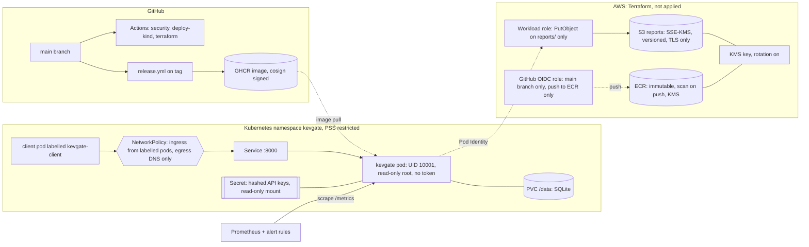

# Deployment

This describes how kevgate is packaged for Kubernetes and AWS, why each control is there, and
which parts have actually been exercised. The next two sections matter most if you are deciding
how much to trust the rest: what is validated where, and what is unused or unproven.

## What is validated where

| Claim | Local static (Windows workstation) | CI on a kind cluster | Not done |
|---|---|---|---|
| Helm chart lints strictly and renders valid Kubernetes objects | yes: `helm lint --strict`, `kubeconform -strict` on three values files | repeated in `security.yml` | |
| Chart refuses unsafe values (privilege escalation, writable root FS, `latest`, SQLite split across replicas) | yes, rendered each case and saw the failure | repeated in `security.yml` | |
| Dockerfile and manifests pass policy scans | yes: checkov and trivy config | repeated | |
| Terraform is valid and linted | yes: `fmt`, `init -backend=false`, `validate`, tflint, checkov, trivy config | repeated in `terraform.yml` | |
| Terraform creates the intended resources | no | `terraform apply` against LocalStack, then API checks on the result, then `destroy` | never applied to real AWS |
| Alert rules are syntactically valid and fire as designed | yes: `promtool check rules` and `promtool test rules` | repeated | never run against a live Prometheus |
| Sigma rules are valid | yes: `sigma check`, converted to Splunk SPL as a second check | repeated | never run in a SIEM |
| Image builds, runs as UID 10001 with a read-only root | no (no Docker here) | `security.yml` builds and starts it with `--read-only --cap-drop ALL`, then runs the smoke test | |
| Image has no fixable HIGH or CRITICAL CVEs | no | Trivy gate in `security.yml` and `release.yml` | |
| Pod runs with the restricted security context, probes pass, rollout completes | no | `deploy-kind.yml` | |
| NetworkPolicy is enforced (unlabelled pod blocked, labelled pod allowed, egress denied) | no | `deploy-kind.yml` with Calico installed | |
| Pod Security Admission rejects a privileged pod | no | `deploy-kind.yml` | |
| API behaviour (401 without key, 422 on bad input, ordering) | no | `deploy/smoke.sh` in CI | |
| Running service has no medium or higher ZAP alerts | no | ZAP baseline, gated | baseline is passive plus a light spider, not a full active scan |
| K8s audit events match the Sigma rules' fields | no | `audit-check.sh` greps the kind API server audit log | |
| Signed, attested release image | no | `release.yml` on a tag | |
| Pushing to ECR through GitHub OIDC | no | | needs an AWS account |
| Pod Identity role assumption from EKS | no | | needs an AWS account and an EKS cluster |
| Real storage class, node drain behaviour, HA | no | | kind is one node with local storage |

All four CI workflows (`ci`, `security`, `deploy-kind`, `terraform`) have run green on GitHub
Actions; the first run of each was not green and the problems it exposed are listed in
`docs/PIPELINE.md` under "What the first CI run found". `release.yml` ran once, on tag `v0.1.0`,
and every step succeeded. The signature and attestation of that image have not been verified
independently (`cosign verify`, `gh attestation verify`), and nothing in the cluster enforces them.

## What is unused or unproven

Stated plainly, so none of it has to be inferred from the tables:

- **The Terraform resources have no consumer in the deployed path.** The reports bucket, the KMS
  key, the ECR repository, the workload role and the GitHub CI role are not used by anything: the
  service contains no AWS SDK code, the workflows contain no `role-to-assume`, and releases go to
  GHCR. The Terraform shows how such resources would be defined and constrained; it is not part of
  how the service runs.
- **Terraform was only applied to LocalStack**, never to a real AWS account. The ECR repository
  and the GitHub OIDC role are not even created there (LocalStack Community has no ECR), so they
  are checked statically (`validate`, tflint, checkov, trivy config) plus the `terraform test`
  regression described under Terraform. EKS Pod Identity trust has never been exercised.
- **One replica on SQLite is a limitation, not a design for production.** Every rollout is an
  outage, a node loss waits on the volume, and there is no backup or restore procedure that has
  been tested. See "What would change for production" below.
- **Alert rules and the dashboard never ran against a live Prometheus.** They are checked by
  `promtool` unit tests and schema validation only.
- **The Sigma rules never ran in a SIEM.** `audit-check.sh` is a hand translation to `jq` that
  checks field names against a real kind audit log.
- **Image signature enforcement, admission policy, node drains, multi-node scheduling and load
  behavior** were not tested.

## Architecture



## Image

`Dockerfile` is two stages. The builder installs the committed `requirements.lock` with `--require-hashes`
into a virtualenv and builds the kevgate wheel. The runtime stage copies only the virtualenv.

- Base image is pinned by tag and manifest-list digest. The digest was resolved from the Docker Hub
  registry API (`registry-1.docker.io/v2/library/python/manifests/3.12.16-slim-trixie`). The tag
  is for humans; the digest is what gets built. `deploy/scripts/check-base-digest.sh` runs in CI
  and warns when upstream has moved, so the pin is bumped on purpose.
- UID and GID 10001, no home directory, `nologin` shell. `/data` is the only writable path.
- pip is removed from both the builder venv and the runtime interpreter.
- There is a shell in the image (Debian slim ships `sh`). A distroless base would remove it, but
  The slim image is used so `kubectl exec` debugging and the egress test in `netpol-test.sh` can
  run Python. The Sigma rules treat any exec into the pod as an alert anyway. Moving to distroless
  is the next step if that test is dropped.
- `HEALTHCHECK` uses Python's `urllib`, so it needs neither curl nor a shell. Kubernetes uses its
  own probes.
- `CMD ["kevgate", "serve", ...]` in exec form, so uvicorn is PID 1 and gets SIGTERM.

## Helm chart

`deploy/helm/kevgate`, validated by `values.schema.json`. The security settings are not only
defaults; the schema rejects values that weaken them.

| Area | Setting |
|---|---|
| Pod | `runAsNonRoot`, UID/GID/fsGroup 10001, `seccompProfile: RuntimeDefault`, `automountServiceAccountToken: false`, `enableServiceLinks: false` |
| Container | `allowPrivilegeEscalation: false`, `privileged: false`, `readOnlyRootFilesystem: true`, `capabilities.drop: [ALL]` |
| Resources | requests and limits for CPU, memory and ephemeral storage |
| Probes | startup and liveness on `/healthz`, readiness on `/readyz` |
| Storage | PVC for `/data` (kept on uninstall), `emptyDir` mode for throwaway use, memory-backed `/tmp` |
| Secrets | API key file from a Secret mounted read-only at `/etc/kevgate/keys`, mode 0440. `apiKeys.existingSecret` is the default path. The chart can render a Secret from hashed lines for tests. |
| Network | NetworkPolicy: ingress only from pods labelled `kevgate-client=true` on port 8000 (optionally other namespaces, optionally Prometheus). Egress only to cluster DNS, with an optional HTTPS rule that excludes private ranges and the metadata address. |
| Availability | PodDisruptionBudget, optional HPA, optional ServiceMonitor |
| Guard rails | the chart fails to render if replicas or HPA would split SQLite state, if prod has no key source, or if the tag is `latest` |

Install into a namespace that enforces Pod Security Standards:

```bash
kubectl apply -f deploy/kind/namespace.yaml     # labels: enforce/warn/audit = restricted
kubectl -n kevgate create secret generic kevgate-api-keys --from-file=api_keys=./api_keys
helm upgrade --install kevgate deploy/helm/kevgate -n kevgate \
  --set image.digest=sha256:<digest from the release>
```

`api_keys` holds lines from `kevgate keygen`. The plaintext key is shown once and given to the
client; only the hash goes into the cluster.

### Known chart limits

- State is SQLite on one PVC, so it runs one replica with `Recreate` rollouts. Scaling out needs
  a different store (the README already plans Postgres), not a bigger `replicaCount`.
- `kind` has one node and local-path storage. Node drains and zone failures have not been tested.

## Local cluster (needs Docker)

```bash
make -f deploy/Makefile docker-build kind-up kind-load helm-install smoke kind-netpol kind-audit
make -f deploy/Makefile kind-down
```

`kind-up` disables kindnet and installs Calico, because kindnet does not enforce NetworkPolicy.
A test that passes without enforcement would prove nothing, so the CI job and the Makefile both
run an unlabelled pod and require the connection to fail.

## Terraform

`infra/terraform/modules/kevgate` holds the resources. Two roots use it:
`infra/terraform/aws` for a real account and `infra/terraform/localstack` for CI.

| Resource | Controls |
|---|---|
| KMS key | rotation on (365 days), 30 day deletion window, key policy limited to account administration, alias `alias/kevgate` |
| ECR | immutable tags, scan on push, KMS encryption, lifecycle policy, repository policy denying pushes from anyone but the CI role |
| Reports bucket | block public access (all four), `BucketOwnerEnforced`, versioning, SSE-KMS with bucket key, TLS 1.2+ only, a policy that denies uploads using another KMS key, lifecycle (IA at 30 days, expiry, noncurrent expiry, abort multipart), access logging |
| Access log bucket | same public-access and TLS controls, SSE-S3 because S3 log delivery cannot write to a KMS-encrypted bucket |
| GitHub OIDC role | trust requires `aud = sts.amazonaws.com` and `sub = repo:samiali38183/kevgate:ref:refs/heads/main` with `StringEquals`, so PRs, forks, tags and other branches cannot assume it. Permissions: push and read-back on one ECR repository, plus `ecr:GetAuthorizationToken` (AWS does not allow scoping that action) |
| Workload role | trusts EKS Pod Identity for the `kevgate` namespace and service account only (and one cluster if `eks_cluster_arn` is set). Permissions: `s3:PutObject` on `reports/*` and KMS use through S3. No list, no read, no delete |

Variables have validation (account IDs, branch names without wildcards, retention minimums). The
AWS root requires `allowed_account_ids`, so a wrong profile fails before any API call.

State is local by default so that `validate` works without an account. For a real account, copy
`infra/terraform/aws/backend.s3.tf.example` to `backend.tf`. It uses an S3 backend with
`use_lockfile = true` (Terraform 1.10 and later). The DynamoDB lock table that older guides use
is shown commented out; it is deprecated upstream, so it is not the default.

Checkov skips are inline with a reason: the KMS key policy `"*"` resource (it means "this key"),
no event notifications on the reports bucket (no consumer), no cross-region replication
(single-region, no recovery requirement), and three on the log bucket (S3 log delivery limits).
One Trivy ignore is documented for a Deny statement with a wildcard principal.

LocalStack runs Community, which has no ECR, so the LocalStack root sets `enable_ecr = false`.
The ECR and OIDC-role code is therefore checked statically only; `validate`, tflint, checkov and
Trivy cover it, and the OIDC provider is created in LocalStack.

### OIDC trust regression check

The CI role's trust policy is the one place where a small edit (`StringEquals` to `StringLike`, or
a `*` in the `sub` value) would let any workflow in the repository, including pull request runs,
assume the role. `validate`, tflint, checkov and Trivy all accept that weakened policy, so the
shape is pinned by a test instead: `infra/terraform/modules/kevgate/tests/oidc_trust.tftest.hcl`.
It runs with `terraform test` (job `oidc-trust` in `terraform.yml`, no AWS account needed because
the provider is mocked) and fails unless:

- the trust statement is a single `Allow` of `sts:AssumeRoleWithWebIdentity`;
- it has exactly two conditions, both `StringEquals`;
- `token.actions.githubusercontent.com:aud` is exactly `sts.amazonaws.com`;
- `token.actions.githubusercontent.com:sub` is exactly one value,
  `repo:samiali38183/kevgate:ref:refs/heads/main`, with no `*` or `?` anywhere;
- a wildcard in `github_repository` or `github_branch` is rejected by variable validation.

The test was run against a deliberately weakened policy (`StringLike` plus `repo:...:*`) and
failed on three assertions; it passes on the real one. It checks the policy as written in
Terraform, not what AWS stores after an apply, and it does not cover branch protection on `main`:
anyone who can push to `main` still controls what runs with that `sub`. Branch protection is not
configured for this repository.

## Security controls

| Layer | Control | Enforced by | Evidence |
|---|---|---|---|
| Supply chain | locked, hash-verified dependencies (`requirements.lock` is committed; refresh with `deploy/scripts/lock.sh refresh`) | `pip --require-hashes` in `ci` and in the image build; weekly `lock-freshness` and Dependabot flag staleness | image build in CI |
| Supply chain | pinned base digest, pinned actions by SHA, pinned tool checksums | Dockerfile, workflows, `install-tools.sh` | grep in review, actionlint |
| Supply chain | signed image and provenance | cosign keyless, `attest-build-provenance` | `release.yml` verify step |
| Build | CVE gate on HIGH and CRITICAL with a fix | Trivy | `security.yml`, `release.yml` |
| Build | SAST, SCA, secret scan | Semgrep, Bandit, pip-audit, gitleaks | `security.yml` |
| Runtime | non-root, read-only root, no capabilities, seccomp, no SA token | pod spec, PSS `restricted` | kind job checks the live pod |
| Network | default deny both directions with explicit allows | NetworkPolicy plus Calico | `netpol-test.sh` |
| Admission | privileged pods refused | Pod Security Admission | `netpol-test.sh` |
| Identity | hashed, scoped API keys, mounted read-only | app and Secret | smoke test (401, 422) |
| Cloud | encryption, TLS-only, no public access, least-privilege roles, no static keys | Terraform | LocalStack apply checks, static scans (not consumed by the service, see above) |
| Cloud | CI role trusts only `ref:refs/heads/main` of this repository | `StringEquals` on `aud` and `sub` | `terraform test` in `terraform.yml` |
| Identity | brute force of key values or ids is throttled per source address before authentication | failure limiter in `app.py` | `tests/test_auth_failures.py` |
| Detection | alerts for 5xx, auth failures, rate limiting, readiness, latency | Prometheus rules | `promtool test rules` |
| Detection | audit-log rules for exec, secret reads, privileged pods, ephemeral containers | Sigma | `sigma check`, `audit-check.sh` |
| Response | runbook with key-leak and pod-compromise playbooks | `docs/RUNBOOK.md` | review |

## Not covered

- No WAF, ingress controller or TLS termination. The Service is `ClusterIP`; ingress and TLS are
  the cluster's job and would be added in front.
- No admission policy engine (Kyverno or Gatekeeper) beyond Pod Security Admission.
- No image signature verification at admission. Signing exists; enforcing it in the cluster does
  not.
- No secrets manager integration. The API key Secret is created by hand or by an operator that is
  not installed here.
- Prometheus, Grafana and the Operator are not deployed by this repo. The rules, CRD and
  dashboard are provided and checked, not run.

## What would change for production

The current deployment is a single-replica demonstration. Replacing the following would be the
minimum before running it for real:

1. **Storage: Postgres instead of SQLite.** SQLite on one ReadWriteOnce volume forces one replica
   and `Recreate` rollouts. A managed Postgres removes the single-writer file, lets the chart use
   `RollingUpdate` with several replicas, and makes the pod stateless. The repository class in
   `db.py` is the only place with SQL, so the change is contained; the schema constraints and
   migrations would move into the new store.
2. **Replicas and disruption.** With state external: at least two replicas, a PodDisruptionBudget
   with `minAvailable: 1` (that setting blocks drains today because there is one replica),
   anti-affinity or topology spread across nodes, and an HPA. The in-memory rate limiter and
   failure limiter then need a shared store (or a gateway limit), because each replica currently
   keeps its own buckets.
3. **Backup and restore.** Today the only procedure is copying `/data/kevgate.db`, and it has never
   been restored in a test. Needed: scheduled backups (managed Postgres snapshots and point in time
   recovery, or for SQLite a CronJob running `sqlite3 .backup` to a second volume or object
   storage), retention, and a restore drill whose duration is recorded.
4. **Key lifecycle.** Keys and the KEV catalog are read once at startup, so changing either means a
   restart (and, with one replica, an outage). Production needs hot reload or a managed secret
   source, plus key expiry and last-used tracking.
5. **Observability that has run.** Run the alert rules and dashboard against a real Prometheus,
   add a volume-usage alert (`kubelet_volume_stats_used_bytes`), measure latency against row count
   and set the latency threshold from that baseline, and ship logs somewhere durable.
6. **Supply-chain enforcement.** Verify the cosign signature at admission (Kyverno or a similar
   controller), deploy by image digest, and turn on branch protection with required checks for
   `main`.
7. **AWS.** Either wire the Terraform resources into something that uses them (push the release
   image to ECR through the OIDC role, have the service write reports) or delete `infra/`. As it
   stands it is unused.
