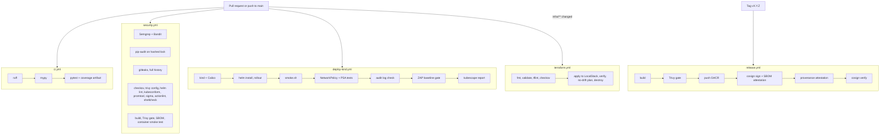

# Pipeline

Six workflows in `.github/workflows/`: the five below plus `lock-freshness.yml` (weekly check that `requirements.lock` is current, described under Lock file; it is scheduled and has not run yet). The aim is that a pull request cannot reach `main` with a
known-vulnerable dependency, a leaked secret, a weakened pod spec or an unscanned image, and that
a release carries proof of where it came from.



## What each workflow proves

| Workflow | Triggers | Proves | Fails when |
|---|---|---|---|
| `ci.yml` | PR, push to main | Code is lint-clean, type-clean (mypy strict) and tested on Python 3.11 and 3.12 | ruff, mypy or pytest fails, or coverage is under the app's `fail_under` |
| `security.yml` | PR, push to main, weekly | No SAST findings, no known-vulnerable locked dependency, no secrets in history, infra files pass policy, image has no fixable HIGH or CRITICAL CVE, hardened container still passes the smoke test | any scanner reports above its threshold |
| `deploy-kind.yml` | PR, push to main | The chart deploys on a real cluster with the restricted profile; the API behaves; NetworkPolicy and admission enforce; the audit log has the events the Sigma rules need; DAST finds nothing medium or higher | rollout, smoke, policy tests or the ZAP gate fail |
| `terraform.yml` | PR and push touching `infra/` | Terraform is formatted, valid and linted, and applies, matches its intended controls and destroys cleanly against LocalStack | any step fails |
| `release.yml` | tag `v*.*.*` | The published image was scanned before and after push, is signed by this workflow's identity, and has provenance and an SBOM | scan fails, or signature verification of the pushed digest fails |

## Design choices

**Least privilege per job.** Each workflow starts with `permissions: {}`, and each job asks for
what it needs. Only the SARIF-uploading jobs get `security-events: write`; only `release.yml` gets
`packages: write`, `id-token: write` and `attestations: write`. Checkouts use
`persist-credentials: false`.

**Third-party actions pinned by commit SHA**, with the tag in a comment. Tools that are not
actions (kind, helm, trivy, gitleaks, promtool and so on) are installed by
`deploy/scripts/install-tools.sh` from pinned versions with committed checksums, which keeps
extra JavaScript with a job token out of the picture.

**No secrets in the repo.** Each kind run generates a fresh API key with the image's own
`kevgate keygen`, stores only the hash in the cluster Secret and masks the plaintext in logs. The
key lives in the runner's temp directory and dies with the runner. LocalStack's `test`
credentials are its documented dummy values and are annotated for checkov.

**Gate at a stated threshold.** Trivy fails on HIGH and CRITICAL with `--ignore-unfixed`:
an unfixable base-image CVE should not block a merge, but it still appears in the SARIF and SBOM.
ZAP's own exit code is coarse, so `deploy/scripts/zap-gate.sh` reads the JSON report and fails
on any medium or higher alert whose rule id is not ignored in `deploy/zap/rules.tsv`. Every
ignored rule has a reason in that file. The initial entries are informational or cookie rules
that cannot apply to a cookie-less JSON API. The file is expected to need tuning as real runs accumulate.

**Lock file.** `requirements.lock` is committed. It was compiled by `deploy/scripts/lock.sh` with
pip-tools (`--generate-hashes`) from `pyproject.toml` on a Linux runner with Python 3.12, so it
matches the image. `ci` installs it with `--require-hashes` before the dev tools, `pip-audit`
scans that exact file, the Docker build installs it with `--require-hashes`, and the SBOM
describes the built image. To refresh it run `bash deploy/scripts/lock.sh refresh` (on Linux,
Python 3.12), review the diff and commit it in a pull request. Staleness is flagged two ways:
Dependabot (pip, github-actions and docker, weekly, `.github/dependabot.yml`; actions stay pinned
to a commit SHA and Dependabot updates the SHA and its version comment together) and the weekly
`lock-freshness.yml` workflow, which compiles a fresh lock and fails when its pinned versions
differ from the committed file. Dependabot does not recognise `requirements.lock` as an input, so
the workflow is the check that covers it.

**Real enforcement tests.** `deploy-kind.yml` installs Calico because the default kind CNI
(kindnet) does not enforce NetworkPolicy. `netpol-test.sh` requires an unlabelled pod to fail to
connect, a labelled pod to succeed, the kevgate pod to fail an outbound connection to the
internet, and a privileged pod to be rejected at admission.

**Release order.** Build locally, scan, then push; sign the digest that was pushed, then verify
the signature against the workflow identity before the job succeeds. Signing is keyless: the
certificate comes from GitHub's OIDC token and is logged in Rekor, so there is no signing key to
protect or rotate. To verify an image yourself:

```bash
cosign verify ghcr.io/samiali38183/kevgate@sha256:<digest> \
  --certificate-identity-regexp '^https://github.com/samiali38183/kevgate/\.github/workflows/release\.yml@refs/tags/v' \
  --certificate-oidc-issuer https://token.actions.githubusercontent.com
gh attestation verify oci://ghcr.io/samiali38183/kevgate@sha256:<digest> --repo samiali38183/kevgate
```

**SARIF only where it works.** Code scanning upload is skipped for private repositories, where
GitHub does not offer it for free; the SARIF is kept as an artifact either way.

## Validated locally before pushing

On a Windows workstation (no Docker):

| Check | Command | Result |
|---|---|---|
| Workflow syntax and embedded shell | `actionlint` | clean |
| Scripts | `shellcheck -x deploy/smoke.sh deploy/scripts/*.sh deploy/monitoring/*.sh` | clean |
| Action pinning | grep for `uses:` lines without a 40-character SHA | none |
| Helm | `helm lint --strict` on three values files, `helm template \| kubeconform -strict` | clean, 6 / 6 / 8 resources valid |
| Chart guard rails | four unsafe `--set` cases | all rejected |
| Terraform | `fmt -check`, `init -backend=false`, `validate`, tflint | clean on both roots and the module |
| OIDC trust | `terraform test` in `modules/kevgate` | passes; fails against a `StringLike` plus wildcard `sub` |
| checkov | Dockerfile, rendered chart, Terraform | 0 failed (skips justified inline) |
| trivy config | Dockerfile, chart, Terraform | 0 findings at MEDIUM and above |
| promtool | `check rules`, `test rules` | 8 rules, all unit cases pass |
| Sigma | `sigma check`, convert to Splunk | 0 issues, 4 rules convert |
| ZAP gate | sample reports | fails on a medium alert, passes when only ignored ones are present |

What these cannot show is in the table at the top of `docs/DEPLOYMENT.md`.

## What the first CI run found

The first run of `security` and `deploy-kind` failed, and `terraform` had not yet run. Fixes, each
verified by a green run:

| Finding | Cause | Fix |
|---|---|---|
| IaC job could not install tools | checkov and sigma-cli pin incompatible dependency ranges | each is installed in its own virtualenv and put on `PATH` |
| Bandit B608 (3 medium) in `db.py` | SQL built with an f-string from a constant column list; not injectable, but indistinguishable from the real pattern to a scanner | the three queries are now complete string constants, no `nosec` needed |
| Trivy: 2 HIGH in `zlib1g` (CVE-2026-76844, CVE-2026-85091) with a Debian fix | the pinned base image digest was the latest upstream, and it still shipped the unfixed package | the runtime stage runs `apt-get upgrade` and removes the apt lists in the same layer; the Trivy gate is unchanged and now passes |
| Container smoke test: connection refused | the generated key file is mode 0600 for the runner, the container runs as UID 10001 and could not read it | the file (hash only, not the key) is made 0644 before mounting; logs are printed if startup fails |
| Audit check: "default service account can read the secret" | kubectl prefers the client certificate in kubeconfig over `--token`, so the request ran as cluster admin | the attempt uses a throwaway kubeconfig that holds only the cluster CA and the service account token, so the audit event carries the right user |
| LocalStack apply: S3 tag listing returned 403 | the provider lists bucket tags through S3 Control, which was not pointed at LocalStack | `s3control` endpoint set in the LocalStack root and the service enabled in the container |

`terraform.yml` also gained `workflow_dispatch` so it can be run on demand.

## Running the same checks locally

```bash
make -f deploy/Makefile helm-lint helm-template tf-fmt tf-validate tf-lint
promtool test rules deploy/monitoring/kevgate-rules.test.yaml
sigma check deploy/detections
```

With Docker available, `make -f deploy/Makefile docker-build kind-up kind-load helm-install smoke
kind-netpol kind-audit` runs the kind job's steps by hand.

## Known limits

- `release.yml` ran for tags `v0.1.0` and `v0.1.1` and every step succeeded. On 2026-11-12 `gh attestation verify oci://ghcr.io/samiali38183/kevgate:0.1.1 --repo samiali38183/kevgate` succeeded from a machine outside the workflow (provenance only; `cosign verify` has not been run independently), and nothing enforces the signature in a cluster.
- The kubescape step produces a report and does not gate. Its host scanner cannot start on kind
  (no node-agent), so only the manifest-level controls are scored: NSA 79.96, MITRE 77.73. No
  score threshold that means something for this chart has been chosen.
- ZAP baseline is a passive scan plus a short spider. It is not an active scan, and an API without
  an OpenAPI import gives it little to crawl. Importing the OpenAPI document is the next step.
- The Terraform job's no-drift plan after apply depends on LocalStack's fidelity. It passed on the
  last run on `main`; if it ever flaps, that step should be removed rather than weakening the controls it checks.
