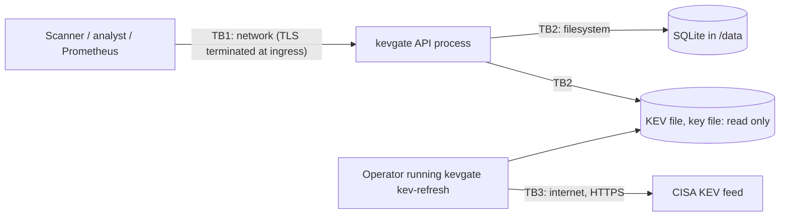

# kevgate threat model

Method: STRIDE per component. For each threat I list what is implemented in this repo (with the file that does it) and what risk remains. Scope is the application as of the `feat/app-core` branch. Controls that belong to the container and cluster layer are listed under the container component as requirements the app is built to support, since that layer lives in `deploy/`.

## What is worth protecting

- Integrity of the queue. If an attacker can insert, change or delete findings, they can push a real exploited vulnerability down the list or bury it. This is the main asset.
- Confidentiality of the findings. A list of which hosts have which unpatched KEV CVEs is a target list for an attacker.
- The API keys, and the key file that holds their hashes.
- Availability, mostly so scanners can keep submitting.

## Trust boundaries

Assumptions: TLS is terminated before the pod (ingress or service mesh); the key file is mounted from a secret; only Prometheus can reach `/metrics` (NetworkPolicy); the process runs as non-root with a read-only root filesystem and only `/data` writable.

## 1. API (HTTP surface)

| STRIDE | Threat | Implemented mitigation | Residual risk |
|---|---|---|---|
| Spoofing | Caller pretends to be a scanner or admin | Bearer key required on every data endpoint (`app.py: require`) | Ops endpoints are unauthenticated by design; rely on NetworkPolicy for `/metrics` |
| Tampering | Malformed or oversized input corrupts data or crashes the parser | Strict Pydantic models with `extra="forbid"`, no coercion, NaN rejected, CVE regex, printable asset names (`models.py`); 1000 findings per request; whole batch in one transaction (`db.py: upsert_many`); CSV rejected as a whole on any bad row (`csv_import.py`) | A valid key can still submit false but well-formed data. Ingestion is trusted once authenticated |
| Tampering | SQL injection through asset or CVE values | Every query is parameterised; schema has CHECK constraints (`db.py`) | None known |
| Repudiation | A key holder denies deleting or overwriting findings | One JSON log line per request with method, path, status, request id and key_id (`middleware.py`) | Logs are not signed and live only as long as the log pipeline keeps them; the log records who called DELETE, not the prior values |
| Information disclosure | Error responses reflect client data or internals | Custom 422 handler drops submitted values (`app.py: _validation_error_handler`); unhandled errors return a generic 500 and the traceback goes to logs only; `/docs` and `/openapi.json` are off in prod | Field names and limits are visible in 422 messages, which is intended |
| Information disclosure | Browser or proxy caches findings | `Cache-Control: no-store`, `nosniff`, `X-Frame-Options: DENY`, strict CSP, no referrer (`middleware.py`) | uvicorn's `server` header remains when launched with plain `uvicorn` and no `--no-server-header` |
| Denial of service | Large or slow bodies exhaust memory | 1 MiB limit on declared length and on streamed chunks (`middleware.py: BodySizeLimitMiddleware`) | Slowloris-style slow uploads are left to the ingress and uvicorn timeouts |
| Denial of service | One client floods the API | Per-key token bucket, 429 with `Retry-After` (`ratelimit.py`) | Per replica and in memory. Unauthenticated requests are not limited by the app, so invalid-key floods need an ingress limit. Queue and stats score every row on each call, which is fine at tens of thousands of findings but not millions |
| Elevation of privilege | A read or write key performs admin actions | Scope check after authentication, admin implies all, 403 on mismatch (`auth.py: Principal.allows`) | Scopes are global; there is no per-asset or per-team authorization |

## 2. Authentication and key management

| STRIDE | Threat | Implemented mitigation | Residual risk |
|---|---|---|---|
| Spoofing | Guessing a key | Keys are `kvg_` plus 32 bytes from `secrets` (256 bits) (`auth.py: generate_key`) | None practical |
| Spoofing | Timing side channel reveals key bytes or which key matched | SHA-256 digest compared with `hmac.compare_digest` against every stored key with no early exit (`auth.py: KeyStore.authenticate`) | None known |
| Information disclosure | Key file or a backup leaks | Only SHA-256 hashes are stored. Because the keys are high-entropy random strings, a fast hash is enough; a slow hash like scrypt would protect nothing extra and would cost CPU on every request | A leaked plaintext key stays valid until removed. There is no expiry, no last-used tracking, and revocation needs a restart |
| Information disclosure | Keys end up in logs | Only `key_id` is logged; the access log has no headers or bodies; a test asserts the key never appears (`tests/test_api.py`) | Upstream proxies may log the `Authorization` header if misconfigured |
| Tampering | Broken or edited key file grants unexpected access | Strict parser: unknown scopes, bad ids, bad hashes and duplicate ids abort startup (`auth.py: KeyStore.parse`) | Anyone who can write the key file can add an admin key; protect it as a secret |
| Elevation of privilege | Service accidentally runs without auth in production | `KEVGATE_ENV=prod` without a key file, or with an empty one, refuses to start (`app.py: _load_keys`); dev mode logs a loud warning | Someone can still deploy with `KEVGATE_ENV=dev`. The Helm values should pin `prod` |

## 3. Database (SQLite)

| STRIDE | Threat | Implemented mitigation | Residual risk |
|---|---|---|---|
| Tampering | Partial writes leave the queue inconsistent | Batches run in `BEGIN IMMEDIATE` transactions with rollback (`db.py: _tx`); WAL mode | Anyone with write access to `/data` can edit the DB directly; no row-level integrity checks or audit table |
| Tampering | Schema drift between versions | Versioned migrations recorded in `PRAGMA user_version` (`db.py: migrate`) | Migrations are forward only; there is no down migration |
| Information disclosure | DB file copied off the volume | File permissions and volume encryption are platform controls | Data at rest is not encrypted by the app |
| Denial of service | Disk fills or file is locked | `busy_timeout` of 5 s; `/readyz` reports `db: fail` when the DB stops answering | One writer at a time, and one SQLite file cannot be shared by several replicas. Horizontal scaling needs Postgres |

## 4. KEV feed

| STRIDE | Threat | Implemented mitigation | Residual risk |
|---|---|---|---|
| Spoofing | Fetching a fake feed | `kev-refresh` only accepts `https://` URLs and uses the system trust store (`kev.py: fetch_kev_feed`) | No signature or checksum from CISA to verify against; a compromised CISA endpoint or trusted CA would be accepted |
| Tampering | Truncated, malformed or poisoned feed (for example removing a CVE so it drops in priority) | Pydantic schema check, every `cveID` must match the CVE pattern, `count` must equal the number of entries, optional `--min-entries` floor, write to a temp file then atomic rename (`kev.py: refresh_kev`) | A well-formed feed with entries removed would pass. Diffing against the previous catalog and alerting on removals would close this |
| Denial of service | Huge or hanging response | 30 s default timeout and a 32 MiB read cap | None significant |
| Denial of service | Bad KEV file at startup | The process still starts but `/readyz` returns 503 so it gets no traffic (`app.py: _load_kev_or_empty`) | Until fixed, the pod stays unready |
| Elevation of privilege | API process making outbound calls (SSRF surface) | The API never fetches anything; refresh is a separate CLI run by an operator or job | None |

## 5. Container and runtime

The image, chart and policies are built in `deploy/`. The app is written so those controls can be strict:

| STRIDE | Threat | What the app does to support the control | Residual risk / owner |
|---|---|---|---|
| Tampering | Attacker with code execution modifies the app or drops tools | Writes nothing except `KEVGATE_DB_PATH` and its `-wal`/`-shm` siblings (tested in `tests/test_config_cli_logs.py`), so the root filesystem can be read-only | Enforced by `readOnlyRootFilesystem` in the chart |
| Elevation of privilege | Container breakout from a root process | Needs no privileges, no capabilities, and listens on 8000 | Enforced by `runAsNonRoot`, dropped capabilities and seccomp in the chart |
| Information disclosure | Secrets baked into the image | Keys come from a mounted file named by env var; nothing secret is in the package | Image scanning (Trivy) in CI |
| Denial of service | One pod starves the node | Bounded request sizes and per-key rate limits keep per-request work small | CPU and memory limits in the chart |
| Spoofing / disclosure | Other pods scrape metrics or call the API | `/metrics` carries no finding data, only counts | NetworkPolicy in the chart |
| Tampering | Vulnerable dependency | Small dependency set: FastAPI, Pydantic, uvicorn, prometheus-client | pip-audit and Trivy in CI |

## Top residual risks, in order

1. An authenticated writer can submit false data. Mitigation would be per-source keys with asset ownership and anomaly alerts on sudden drops in KEV findings.
2. No key lifecycle: no expiry, rotation or revocation without a restart.
3. Rate limiting is per replica and does not cover failed authentication; needs an ingress or gateway limit.
4. The KEV feed is not signed; a removal attack on the feed would not be detected.
5. SQLite limits the service to a single replica; moving to Postgres is the path to HA.
